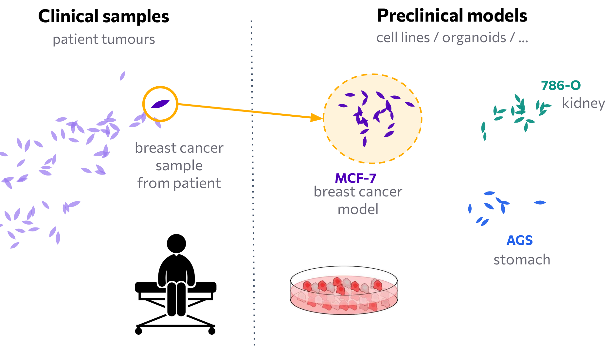
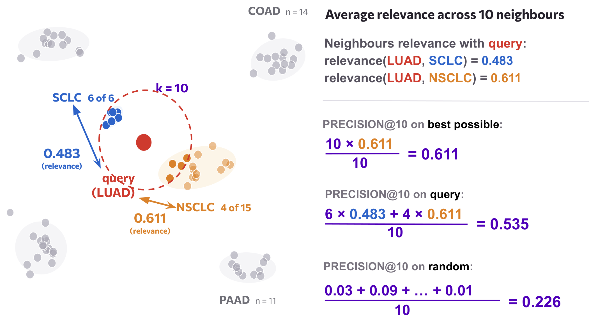
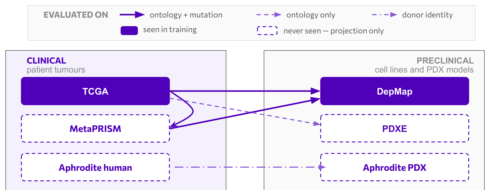
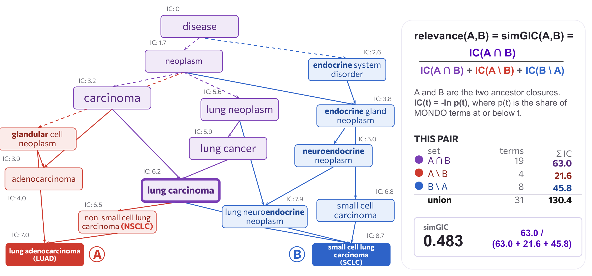
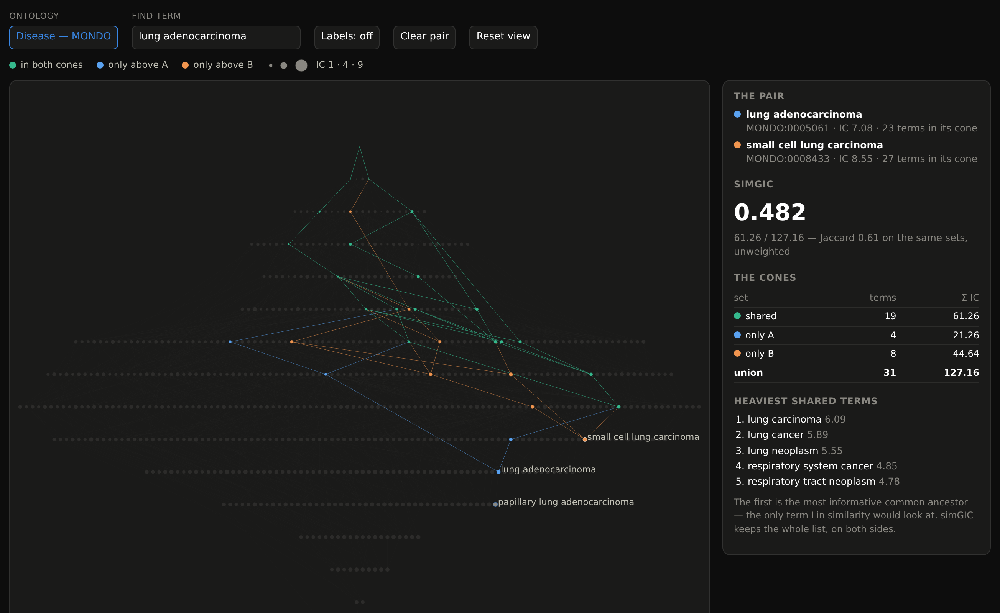

# What counts as a good match?

A three-axis, bounded benchmark for mapping patient tumours to preclinical models.



Embed clinical samples (patient tumours) and preclinical samples (cell lines and
patient-derived xenografts) in one shared space with a model of your choice, retrieve the
k nearest preclinical neighbours of every patient sample, and ask three questions of those
neighbours:

| Axis | Question | Score | Bounds |
|---|---|---|---|
| **Ontology** | Do the neighbours have a similar disease? | simGIC@10 between the query's and each neighbour's MONDO term, a graded graph-based match | random floor, oracle |
| **Mutation** | Do a mutant tumour's neighbours carry its alteration more often than a wild-type tumour's? | AUROC@10, per disease and alteration, of the share of mutant neighbours between mutant and wild-type queries | random 0.5, oracle 1 |
| **Donor** | Is the neighbour the patient's own xenograft? | precision@1, exact match on the donor | random floor, oracle |

Every score is placed between what a random ranking scores and what the best ranking the
database admits could score, so methods are compared on how much of the achievable
interval they cover.



A query's score is the mean relevance of its k neighbours. The floor is that same average
over a random ranking of the database, the oracle over the best ranking the database
admits — here 0.226 and 0.611, so this retrieval covers four fifths of the interval.

## Mappings

| Query → database | Evaluated on | Seen in training |
|---|---|---|
| TCGA → DepMap | ontology, mutation | both |
| MetaPRISM → DepMap | ontology, mutation | DepMap only |
| TCGA → MetaPRISM | ontology, mutation | TCGA only |
| TCGA → PDXE | ontology | TCGA only |
| Aphrodite human → Aphrodite PDX | donor | neither |

Models are fitted on TCGA and DepMap only. The other datasets are embedded by the fitted
model without retraining, so three of the five mappings measure how the embedding
generalises to data it has never seen.



## Methods and bounds

Three baselines are trained from scratch by the workflow, all into 64 dimensions:

- **PCA** on log1p(TPM)
- **scVI**, a variational autoencoder with a negative-binomial likelihood
- **MOBER**, a variational autoencoder with an adversary that removes the dataset of origin
  from the latent space (vendored from [Novartis/MOBER](baseline-models/MOBER/README.md), MIT)

A fourth, **Corr-hvg**, fits nothing: each sample's log1p(TPM) over the gene panel is
standardised, so that Euclidean retrieval ranks the database by Pearson correlation. It is
the floor a learned representation has to beat.

Celligner, BulkFormer and Geneformer were run with external code that is not part of this
repository.

Two bounds are scored on every axis from the labels alone, with no embedding:

- **Random**, the expected score of a uniformly random ranking of the database.
- **Oracle**, the best score any ranking of the database could reach. On the mutation axis
  it hands every query the database samples of its own mutation status first.

## Results

The three baselines as the workflow last ran them, with both bounds on every row.

### Ontology axis (simGIC@10)

| pair | k | MOBER | PCA | scVI | Random | Oracle |
|---|---|---|---|---|---|---|
| metaprism_to_depmap | 10 | 0.248 | 0.246 | 0.239 | 0.104 | 0.556 |
| tcga_to_depmap | 10 | 0.406 | 0.380 | 0.397 | 0.104 | 0.669 |
| tcga_to_metaprism | 10 | 0.369 | 0.373 | 0.377 | 0.126 | 0.634 |
| tcga_to_pdxe | 10 | 0.326 | 0.315 | 0.329 | 0.130 | 0.513 |

### Mutation axis (AUROC@10)

Each pair's primary analyses as one mean AUROC, cancers weighted √n, with 95% intervals:

| pair | cancers | MOBER | PCA | scVI | Random | Oracle |
|---|---|---|---|---|---|---|
| metaprism_to_depmap | BRCA+LUAD | 0.745 [0.675, 0.811] | 0.728 [0.657, 0.797] | 0.769 [0.706, 0.829] | 0.500 | 1.000 |
| tcga_to_depmap | BRCA+COAD+LUAD+SKCM | 0.709 [0.689, 0.730] | 0.626 [0.607, 0.647] | 0.741 [0.720, 0.760] | 0.500 | 1.000 |
| tcga_to_metaprism | BRCA+LUAD | 0.702 [0.680, 0.723] | 0.671 [0.647, 0.693] | 0.732 [0.712, 0.757] | 0.500 | 1.000 |

The primary analyses with at least 10 mutant and 10 wild-type samples on both sides, 24 of
63; `results/summary.md` lists the others with their counts. \* marks a Benjamini–Hochberg
q < 0.05 against shuffled database labels.

| pair | disease | alteration | MOBER | PCA | scVI | Random | Oracle |
|---|---|---|---|---|---|---|---|
| metaprism_to_depmap | BRCA | PIK3CA_core | 0.630 | 0.638 | 0.604 | 0.500 | 1.000 |
| metaprism_to_depmap | LUAD | KEAP1 | 0.818* | 0.722* | 0.848* | 0.500 | 1.000 |
| metaprism_to_depmap | LUAD | KRAS | 0.663* | 0.683* | 0.763* | 0.500 | 1.000 |
| metaprism_to_depmap | LUAD | SMARCA4 | 0.893* | 0.894* | 0.926* | 0.500 | 1.000 |
| metaprism_to_depmap | LUAD | STK11 | 0.879* | 0.822* | 0.927* | 0.500 | 1.000 |
| tcga_to_depmap | BRCA | PIK3CA_core | 0.538 | 0.588 | 0.666 | 0.500 | 1.000 |
| tcga_to_depmap | BRCA | TP53_lof | 0.804* | 0.811* | 0.821* | 0.500 | 1.000 |
| tcga_to_depmap | COAD | BRAF_V600E | 0.932* | 0.660 | 0.849* | 0.500 | 1.000 |
| tcga_to_depmap | COAD | KRAS_MSS | 0.633 | 0.447 | 0.708* | 0.500 | 1.000 |
| tcga_to_depmap | COAD | MSI | 0.946* | 0.870* | 0.955* | 0.500 | 1.000 |
| tcga_to_depmap | LUAD | KEAP1 | 0.818* | 0.623 | 0.795* | 0.500 | 1.000 |
| tcga_to_depmap | LUAD | KRAS | 0.580 | 0.483 | 0.578 | 0.500 | 1.000 |
| tcga_to_depmap | LUAD | SMARCA4 | 0.882* | 0.741* | 0.900* | 0.500 | 1.000 |
| tcga_to_depmap | LUAD | STK11 | 0.788* | 0.492 | 0.798* | 0.500 | 1.000 |
| tcga_to_depmap | SKCM | BRAF | 0.628* | 0.571 | 0.670* | 0.500 | 1.000 |
| tcga_to_depmap | SKCM | NRAS | 0.538 | 0.513 | 0.569* | 0.500 | 1.000 |
| tcga_to_metaprism | BRCA | PIK3CA_core | 0.675* | 0.691* | 0.726* | 0.500 | 1.000 |
| tcga_to_metaprism | LUAD | BRAF | 0.623* | 0.526 | 0.568 | 0.500 | 1.000 |
| tcga_to_metaprism | LUAD | EGFR | 0.875* | 0.806* | 0.861* | 0.500 | 1.000 |
| tcga_to_metaprism | LUAD | KEAP1 | 0.773* | 0.736* | 0.822* | 0.500 | 1.000 |
| tcga_to_metaprism | LUAD | KRAS | 0.599* | 0.510 | 0.619* | 0.500 | 1.000 |
| tcga_to_metaprism | LUAD | SMARCA4 | 0.849* | 0.709 | 0.877* | 0.500 | 1.000 |
| tcga_to_metaprism | LUAD | STK11 | 0.673* | 0.543 | 0.673 | 0.500 | 1.000 |
| tcga_to_metaprism | LUAD | TP53 | 0.748* | 0.691* | 0.753* | 0.500 | 1.000 |

### Donor axis (precision@1)

| pair | k | MOBER | PCA | scVI | Random | Oracle |
|---|---|---|---|---|---|---|
| aphrodite | 1 | 0.319 | 0.128 | 0.447 | 0.021 | 1.000 |

Read as the share of the random-to-oracle interval covered: on the ontology axis the three
methods sit at 48–53% of it wherever TCGA is the query, and at 30–32% on MetaPRISM →
DepMap, the one mapping whose queries were never seen in training. On the mutation axis
microsatellite instability in colon cancer is the clearest signal (0.87–0.96), while the
neighbours of a KRAS-mutant lung tumour from TCGA are barely more often KRAS-mutant cell
lines than those of a wild-type one (0.48–0.58). scVI scores highest in 17 of the 24
analyses and MOBER in 6; PCA is the lowest in 18. Averaged per pair, scVI is highest on
all three pairs (0.73–0.77) and PCA lowest (0.63–0.73). On the donor axis scVI covers 43%,
MOBER 30% and PCA 11%. The numbers above are the workflow's own `results/summary.md`;
rerunning it rewrites them.

## How a score is computed

*Ontology.* MONDO is a directed acyclic graph. A term's *ancestor closure* is the term plus
everything above it, and every term has an information content IC(t) = −ln p(t), where p(t)
is the share of MONDO terms at or below t. The relevance of a neighbour's term B to the
query's term A is

    simGIC(A, B) = IC(A ∩ B) / IC(A ∪ B)

summed over the two closures. Identical terms score 1; a neighbour annotated one level
away still earns credit, which an exact-match metric would not give. Almost every pair of
diseases shares something above the root, so scores floor well above zero, and the random
bound shows where. simGIC@10 is the mean relevance of a query's ten nearest neighbours,
averaged over the queries of each cancer type and then over cancer types, a type with n
queries weighing √n.



The [simGIC explorer](docs/simgic-explorer/simgic_explorer.html) draws the two ancestor
closures of any pair of terms in the benchmark next to their score, on the same graph and
with the same weights the benchmark scores with.



*Mutation.* Scored per disease and alteration, as declared in
[mutation_tasks.yaml](benchmark-workflow/resources/mutation_tasks.yaml): lung
adenocarcinoma (LUAD), colon adenocarcinoma (COAD), cutaneous melanoma (SKCM) and breast
carcinoma (BRCA). The queries are the tumours of the disease's OncoTree codes, the
database the samples of the same codes, each labelled mutant, wild type or unknown for one
alteration: selected protein changes for an oncogene (`hotspot`), truncating, essential
splice-site, start-loss and stop-loss mutations (`lof`), or any protein-changing mutation
(`nonsilent`), plus microsatellite instability for COAD. The same rules label every
source, from the full somatic calls. Wild type means no protein-changing call in the gene,
or none at all where the task says so; a sample with a different protein-changing call in
the gene, or a cell line that lost both copies of it, is unknown and left out. For each
query, s is the share of its ten neighbours that are mutant. AUROC@10 is the probability
that a mutant query's s exceeds a wild-type query's: both share the disease and the
database, so 0.5 means the neighbours know nothing about the alteration beyond the
disease. P-values shuffle the database's labels, and Benjamini–Hochberg q-values are
computed separately for the primary and exploratory analyses. An analysis is scored only
when it has at least 10 mutant and 10 wild-type samples on each side. Each pair's primary
analyses are also summarised by one AUROC per method: the mean over each cancer's
analyses, then over cancers, a cancer with n query patients weighing √n, as on the
ontology axis; its interval resamples each cancer's queries once for all of its analyses.
Pairs are kept apart, since they ask different questions (seen in training or not) and
cover different cancers.

*Donor.* Each patient in the Aphrodite study has a tumour sample and one or two
xenografts grown from it. A neighbour is worth 1 when it is the query's own xenograft.

On every axis a method's 95% interval comes from 1,000 resamples of the queries, with the
database fixed. Each cancer type (a MONDO label, or a mutation analysis's disease) is
resampled within itself and keeps its weight, so the interval reflects which tumours were
drawn, not how many of each type. A TCGA tumour is resampled with its tissue source site,
whose tumours share a processing batch, and any other tumour with its patient. A label of
a single such cluster has no spread of its own; all such labels share one stratum, where a
label's weight follows its draws, so a patient drawn twice counts twice — on the donor
axis, where each label is one donor, as two donors. Every method sees the same resamples.

## Data

Expression and MONDO inputs come from one HuggingFace dataset,
[`ingenix/mapping_benchmark`](https://huggingface.co/datasets/ingenix/mapping_benchmark):
TPM expression for TCGA, DepMap, MetaPRISM, PDXE and the Aphrodite study (GSE317901) on a
common 19,260-gene panel, every sample's MONDO term and the MONDO graph. Which files are
read, and which samples are left out, is in
[resources/datasets.yaml](benchmark-workflow/resources/datasets.yaml). The primary sources
carry their own terms of use; see the dataset card.

The mutation axis reads the somatic calls and clinical annotations of TCGA, DepMap and
MetaPRISM, and MetaPRISM's
[full somatic mutation table](https://github.com/gustaveroussy/MetaPRISM_Public/blob/master/data/README.md)
(Data Table 3). The calls and annotations are on the same HuggingFace dataset, cut to what
the benchmark reads. Every source is pinned to a revision or a SHA-256 in
[resources/mutation_sources.yaml](benchmark-workflow/resources/mutation_sources.yaml).

## Running the benchmark

Prerequisites: [uv](https://docs.astral.sh/uv/getting-started/installation/), about 6 GB
of disk for the inputs and outputs, and a GPU for scVI and MOBER (both fall back to CPU).

```bash
uv sync --locked
for d in baseline-models/*/; do uv sync --locked --directory "$d"; done
uv run --frozen snakemake -s benchmark-workflow/Snakefile --cores 4 --scheduler greedy
```

`--scheduler greedy` selects Snakemake's fast scheduler. Add `-n` for a dry run. A single
cell can be requested by its output file, for example
`results/ontology/tcga_to_depmap/PCA.json`, which downloads the data, selects genes, fits
PCA and scores it without touching the other methods. Everything the workflow decides is
in [config.yaml](benchmark-workflow/config.yaml): the training datasets, the gene panel
size, the k of each axis, the mappings and the methods' hyperparameters. The mutation
axis's diseases, alterations, pairs and scoring settings are in
[mutation_tasks.yaml](benchmark-workflow/resources/mutation_tasks.yaml); adding a cancer
type is an entry there.

The mutation axis alone, on embeddings already in `results/models/`:

```bash
uv run --frozen python benchmark-workflow/scripts/run_mutation_benchmark.py
```

`--diseases LUAD`, `--pairs tcga_to_depmap` and `--methods PCA,scVI` narrow it;
`--bootstrap 25 --permutations 25` makes a quick check.

## Outputs

```
results/models/{method}/            latents.npy, latents.csv, and the fitted model
results/ontology/{pair}/            {PCA,scVI,MOBER,Corr-hvg,Random,Oracle}.json
results/donor/aphrodite/            {PCA,scVI,MOBER,Corr-hvg,Random,Oracle}.json
results/mutation/                   results.json, scores.csv, aggregate.csv (the mean AUROC
                                    per pair), counts.csv, sample_labels.csv,
                                    variant_evidence.csv, manifest.json (input hashes),
                                    report.html and explorer.html (offline, interactive)
results/summary.csv                 every score, one row per axis, pair, disease,
                                    alteration, method, k and metric
results/summary.md                  one table per axis, methods as columns, bounds last
results/summary.pdf, .png           ontology, the mean AUROC per mutation pair and donor
                                    as random-to-oracle bars, with 95% intervals
results/summary_mutation.pdf, .png  AUROC with 95% intervals per alteration and pair
results/mutation/{disease}/summary.pdf, .png   the same, one cancer type per figure
```

Each ontology and donor JSON holds the score per k together with its 95% interval,
per-label scores and the number of query and database samples that were scored. The
mutation `results.json` holds every disease and alteration with its exact query and
database samples, counts, eligibility, intervals, p-values and q-values.

## Adding a method

A method is a `train` step that reads `data/processed/training.h5ad` (TPM on the gene
panel, with a `data_source` obs column) and a `project` step that writes
`results/models/{method}/latents.npy` plus `latents.csv`, the input's obs in the same
order. Add a `methods:` entry with a new `type` in `config.yaml` and a pair of rules in
the [Snakefile](benchmark-workflow/Snakefile) following the PCA ones; the evaluation and
summary rules pick the method up from there.

## Layout

```
benchmark-workflow/     Snakefile, config.yaml, resources/, scripts/ (one script per rule)
src/mapping_benchmark/  datasets (inputs), ontology (MONDO, simGIC), retrieval (axes 1, 3),
                        mutation_tasks (task schema), alterations and mutation_labels
                        (labels), mutation (scores), mutation_report (outputs)
baseline-models/        SimplePCA, scVI, MOBER, each with its own environment
docs/                   the interactive simGIC explorer, and the README figures
tests/                  pytest suite: uv run --frozen pytest
```

## Licence

Apache License 2.0; see [LICENSE](LICENSE) and [NOTICE](NOTICE). The vendored MOBER code in
[baseline-models/MOBER](baseline-models/MOBER/README.md) keeps its upstream MIT licence. The
data has its own terms; see the dataset card.
